# Account delivery plan

Version 0.2, 2026-11-01. D05. **Draft for R01 review.** Reuse the existing
[project](https://github.com/users/ddk220-light/projects/3) and
[numbered backlog](../plans/2026-10-31-accounts-delivery-backlog.md). This document
decomposes work into reviewable tasks; IDs below are task specifications, not a
claim that new GitHub child issues or implementations already exist.

## Milestones and ownership

| Milestone | Exit evidence | Responsible role | Rough effort |
| --- | --- | --- | --- |
| M0 Documents | D01–D05 drafts, decision register and R01 owner review | Codex drafts; Deepak decides | This packet; review/revision time not estimated |
| M1 Visual contract | Claude S22 source/preview, reconciled documents/tasks, R02 approval | Claude creates; engineering reconciles; Deepak decides | 3–6 person-days plus review |
| M2 Foundations | P01–P04 configuration evidence, S01 spike go/no-go, S02–03 isolation | Engineering; Deepak controls vendor accounts/budget | 8–13 person-days; provider waiting time extra |
| M3 Auth and private data | S04–15 and S21 services with focused evidence | Engineering | 18–29 person-days |
| M4 Reader integration | S16–18 approved UI and identity-isolated repositories | Engineering/UI | 9–15 person-days; may overlap M3 |
| M5 Release candidate | T01–T06, S19 validation report, S20 operations and R03 | Engineering/test; Deepak accepts release | 7–12 person-days plus defect fixes |
| M6 Rollout | L01 identified production candidate and smoke/rollback evidence | Release engineer; Deepak authorizes | 1–2 person-days |

Ranges are initial planning estimates for an engineer familiar with this code;
they include focused tests and assume supported Better Auth hooks, available
provider accounts and no auth-library fork. They are not calendar promises.
Account foundation/auth/UI/final work totals roughly 43–71 person-days excluding
M0/M1, external waits and major redesign. Re-estimate after the S01 spike and
after Claude's artifact. No individual is assigned without an actual assignee;
“engineering” denotes responsibility needed, not a claimed staffing commitment.

## Dependency and review order

```mermaid
flowchart LR
    D1[D01 PRD draft] --> D2[D02 UX draft]
    D1 --> D3[D03 engineering and tests]
    D2 --> D4[D04 UI specification]
    D3 --> D4
    D4 --> D5[D05 delivery draft]
    D5 --> R1[R01 document review]
    R1 --> C[S22 Claude artifact]
    C --> R2[R02 artifact and final design approval]
    R1 --> Publish[D05 child-task publication]
    Publish --> R2
    R2 --> P[P01-P04 prerequisites]
    P --> F[S01-S03 foundation]
    F --> A[S04-S10 and S21 auth]
    A --> S[S11-S15 private data]
    A --> U[S16-S18 UI and storage]
    S --> U
    U --> T[T01-T06 final evidence]
    T --> O[S19 validation and S20 operations]
    O --> R3[R03 release acceptance]
    R3 --> L[L01 production]
```

The diagram summarizes milestone flow; exact story dependencies stay in the
published backlog. Core S18 storage can complete without every provider/settings
screen. S16/S17 may build components against reviewed contract fixtures after R02
while corresponding services proceed; completion still requires integration.
P03/P04 vendor work can proceed in parallel with service work once P01/R02 clear.
Do not wait until final testing to discover Apple eligibility or mail-domain gaps.

The latest user instruction supersedes PRD-only-first sequencing: D02/D03 now use
the draft PRD; D04 drafts before S22; R01 reviews **all** drafts; S22 then creates
the artifact and reconciles D02/D04/D05 before R02. Native dependencies must not
retain D02/D03→R01 or D04→S22, which would introduce a review cycle.
R01 consumes the D05 draft but does not wait for closure of D05: that issue also
includes child-issue publication after R01, and R02 remains blocked on it.

## Task definition and publication

Each task below has one observable output, dependencies and evidence. A/B tasks
are implementation/configuration; V tasks verify the resulting behavior. Follow
the parent story's blocked-by issues, then local task order. Test IDs refer to
[TEST_STRATEGY.md](TEST_STRATEGY.md); AC IDs refer to [PRD](PRD.md).

These specifications are ready to review now. D05 remains open until each task
is published as a linked native child issue (or mapped to an existing equivalent),
with owner/estimate and dependencies. Publish after R01 revisions and before R02;
reuse stable IDs to prevent duplicates. S19 already has T01–T06 native children
and should not receive duplicate verification issues. S22's artifact work stays
assigned by role to Claude, not to a fabricated GitHub identity.

### E01 — Foundation (#11)

| Task | Parent / prerequisite | Output and acceptance / evidence |
| --- | --- | --- |
| S01-A | S01 #21; R02 + P01 | Pin compatible auth/client/DB versions and demonstrate all six S01 spike items in ENGINEERING_DESIGN. Deliver compatibility report and generated schema diff; unsupported guarantee gets a reviewed decision, not a workaround hidden in code. |
| S01-B | S01-A | Wire optional auth/private routers in both entry points before retired fallback; distinct cookies and config validation. Public app boots without auth DB; raw request reaches handler. AC-01,03,16. |
| S01-V | S01-B | Local/Vercel integration checks for body/cookie/proxy/redirect behavior, unavailable DB, reset transaction failure injection and measured password-hash concurrency. Feed T01/T02/T05. |
| S02-A | S02 #22; S01 | Versioned auth/application schema, digest/full-key identities, constraints, migrations, auth/migration/runtime/worker grants and provisioning. Fresh DB and upgrade fixture yield expected schema without fuzzy book merges. AC-10,16. |
| S02-V | S02-A | Check unique provider/owner/reference constraints, long catalog keys, runtime grants, transaction rollback, migration dry-run and schema-compatible rollback. Feed T02/T03/T06. |
| S03-A | S03 #23; S02 | Verified-session guard, owner transactions/RLS, origin/CSRF policy, shared limiter, safe errors/no-store, idempotency and version helpers; bounded parser. AC-14,16. |
| S03-V | S03-A | Real two-role/two-user DB and pooled reuse, raw-route bypass tests, two-instance limits, malicious origins/redirects and invalid payload. Feed T02. |

### E02 — Authentication and lifecycle (#12)

| Task | Parent / prerequisite | Output and acceptance / evidence |
| --- | --- | --- |
| S04-A | S04 #24; S03 + P02 | Signup/name/email/password validation, compromised-password policy, durable verification mail and scanner-safe confirmation; unverified users cannot access private reading. AC-02. |
| S04-V | S04-A | Boundary validation, duplicate-enumeration response, resend limits, actual mail, scanner/expiry/replay and guest preservation. T01/T02. |
| S05-A | S05 #25; S04 | Session/bootstrap adapter and idempotent app-user provisioning; 7-day idle/30-day absolute lifecycle, daily renewal and revocation checks. AC-03. |
| S05-V | S05-A | Clock boundaries, missing/revoked session, provision race/deleting user, database outage and no persisted browser tokens. T01/T02. |
| S06-A | S06 #26; S05 + P02 | Neutral recovery, single-use reset, recent-auth password change/setup and correct session invalidation, including social-only accounts. AC-04. |
| S06-V | S06-A | Mail/reset replay/expiry/concurrent use, compromised password, revoked old sessions and no provider-only account takeover. T01/T02. |
| S07-A | S07 #27; S05 | Current/selected/all revocation and safe session listing; bounded labels without raw tokens/IPs; recent-auth proof service. AC-05. |
| S07-V | S07-A | Foreign-session rejection, immediate revocation, failed sign-out and proof expiry/action-binding/replay. UI tab behavior is additionally checked by S18-V. T02/T03. |
| S08-A | S08 #28; S05 + P03 | Google identity scopes, callback/state handling and explicit collision/missing-name outcomes; no email-based merge. AC-06. |
| S08-V | S08-A | Real staging desktop/mobile Google round trip and cancel; fixtures for invalid state/email trust/collisions. T01/T02. |
| S09-A | S09 #29; S05 + P04 | Apple subject/name/relay handling and secure callback integration, rotation configuration and provider revocation capability. AC-06,13. |
| S09-V | S09-A | Real Apple first/repeat/relay/cancel flows including Safari form POST, missing name and secret rotation rehearsal. T01/T06. |
| S10-A | S10 #30; S07 + S08 + S09 | Explicit link intent and unlink services; recent-auth and provider proof; transaction-safe last-method protection. AC-07. |
| S10-V | S10-A | Wrong-account link, occupied subject, relay collision, concurrent last-method unlink, raw endpoint policy bypass. T01/T02. |
| S21-A | S21 #41; S05 + S07 + P02 | Private profile revisions; verified-new-email change, old-address notice, uniqueness-at-commit and session rotation. AC-08. |
| S21-V | S21-A | Profile validation/conflict, expired/replayed/colliding email token, provider-only change and privacy/export result. T01/T02. |

### E03 — Private reading synchronization (#13)

| Task | Parent / prerequisite | Output and acceptance / evidence |
| --- | --- | --- |
| S11-A | S11 #31; S03 + S05 | Single selected directory library, revisioned writes and removed-library outcome. AC-09. |
| S11-V | S11-A | Two devices select concurrently; valid/invalid/removed ID; no user B access; refresh sees acknowledged choice. T03. |
| S12-A | S12 #32; S03 + S05 | Exact-key saves/removes, savedAt, quota, revisioned pagination, conditional undo and clear with receipts. AC-10. |
| S12-V | S12-A | Long/unresolved keys, distinct editions, duplicate/lost-response save, quota, concurrent clear/remove/undo and cursor change. T03. |
| S13-A | S13 #33; S03 + S05 | Opt-in history, server timestamps, generation-based pause/remove/clear, newest 50 / 30 days and cleanup. AC-11. |
| S13-V | S13-A | Controlled delayed views across controls, default-off/expiry/51st-entry/tie-break and read-time expiry despite failed cleanup. T03. |
| S14-A | S14 #34; S11 + S12 + S13 | Atomic bounded guest import, independent history consent/library policy, canonical hash/receipt and result counts. AC-12. |
| S14-V | S14-A | Reordered/duplicate requests, partial DB failure, lost acknowledgement, maximum long-key payload, private snapshot isolation and overflow/corrupt/future timestamps; original snapshot retained. T02/T03. |
| S15-A | S15 #35; S06 + S07 + S10–14 + S21 | Coherent versioned JSON export, deletion status transaction, provider cleanup jobs, suppression ledger and backup policy. AC-13. |
| S15-V | S15-A | Compare export fixture, deletion-versus-write/provision races, lost-response receipt recovery, external-ledger outage, job restart/retry and isolated restore suppression. T02/T06. |

### E04 — UI and reader integration (#14)

| Task | Parent / prerequisite | Output and acceptance / evidence |
| --- | --- | --- |
| S16-A | S16 #36; R02 then reviewed fixtures; completion needs S04–06 + S08–09 | Account routes/forms and provider return; preserve exact safe reading destination and accessible validation. AC-02–04,06,15. |
| S16-V | S16-A + real service dependencies | Browser signup/recovery/provider/error journeys, token-URL cleanup, three lights, keyboard/autofill. T01/T04. |
| S17-A | S17 #37; R02 then fixtures; completion needs S06–07 + S10 + S13 + S15 + S21 | Settings/private profile/email/method/session/history/export/delete; async confirmations and truthful failure states. AC-04–05,07–08,11,13,15. |
| S17-V | S17-A + real service dependencies | Destructive cancellation/reauth/failure, focus restore, data download, session controls and guest/account privacy copy. T01/T04/T06. |
| S18-A | S18 #38; R02 + S05 + S07 + S11–14 | Async reading repositories, user/epoch isolation, cache inventory, BroadcastChannel fallback, local guest override and acknowledged mutations. AC-01,05,09–12,14–15. |
| S18-B | S18-A | Import/consent UI with snapshot-aware cleanup; no account writes in guest or reader local keys; local appearance preserved. AC-12,14. |
| S18-V | S18-B | Two users/devices/tabs, late responses, uncertain session, failed/offline sign-out, guest corruption and exact-key reading regression. T03/T04/T05. |

### E05 — Validation and operations (#15)

| Task | Parent / prerequisite | Output and acceptance / evidence |
| --- | --- | --- |
| T01–T06 | Existing children #42–47 of S19 #39; exact prerequisite sets in backlog | Execute TEST_STRATEGY on one candidate. Each task produces outcomes, reproducible evidence and defects; blockers are not passes. AC-01–17. |
| S19-A | S19 #39; T01–T06 | Consolidate VALIDATION.md with candidate versions, requirement coverage, defects, rerun results and unresolved exceptions. No duplicate final-test child issues. |
| S20-A | S20 #40; draft alongside P01–P04, completion after S19 | OPERATIONS.md with actual configuration/owners, privacy/retention text, scheduled jobs/alerts, backup restore, Apple/mail rotation and rollback steps. AC-13,16–17. |
| S20-V | S20-A + S19 | Another operator follows runbook; check staged drill evidence, cleanup timings, release prerequisites and candidate rollback compatibility. T06/R03. |
| L01-A | L01 #48; R03 | Verify current Vercel repo/branch/domain mapping, approve candidate identity, migrate/enable per runbook, smoke private/public paths and observe rollback signals. AC-17. |

### Prerequisites and Claude artifact

| Task | Dependency | Acceptance / owner |
| --- | --- | --- |
| P01-A / P01-V (#17) | R02 | Configure isolated Postgres roles/pools/stable staging/budget/backup retention; verify actual runtime role, migration path and restore access. Engineering; Deepak supplies vendor authority and spending decision. |
| P02-A / P02-V (#18) | P01 | Mail domain and templates/outbox integration; SPF/DKIM/DMARC, real inbox/relay delivery and failure monitoring. Engineering; Deepak owns domain. |
| P03-A / P03-V (#19) | P01 | Separate Google clients/consent/callbacks; staged credential validation and identity-only scopes. Engineering + provider owner. |
| P04-A / P04-V (#20) | P01 + P02 | Apple eligibility/App ID/Services ID/key/domain/relay/secret-renewal prerequisites; actual callback and mail proof. Missing eligibility blocks Apple release scope. |
| S22-A / S22-V (#56) | R01 | Claude creates source/preview per UI_ARTIFACT brief; inspect all UX flows and reconcile documents/tasks before R02. Claude creates; engineering checks; Deepak reviews. |

## Future discovery remains separate

F01–F07 (#49–55) get definition tasks only: public-profile opt-in/visibility,
work/edition ratings/reviews, comments/moderation, save versus favorite/status,
lists/sharing, follow/block semantics and activity/notification privacy. Each must
define actors, permissions, identity, deletion, abuse and acceptance before an
implementation estimate. None is required for account release or funded by this
plan; private history must never silently become a social activity source.

## Completion rules

For each story: link reviewed requirements, implemented changes, focused test
results and relevant final-test task; ensure no undocumented contract change and
update handoff. Definition issues may stay open for review changes/publication;
their presence on a board does not imply implementation or approval. Before R02,
check native child publication, acyclic dependencies and all implementation paths
reaching R02. Before R03, inspect actual evidence and exceptions. At each review,
record exact document/artifact/candidate commits and Deepak's explicit decision.
