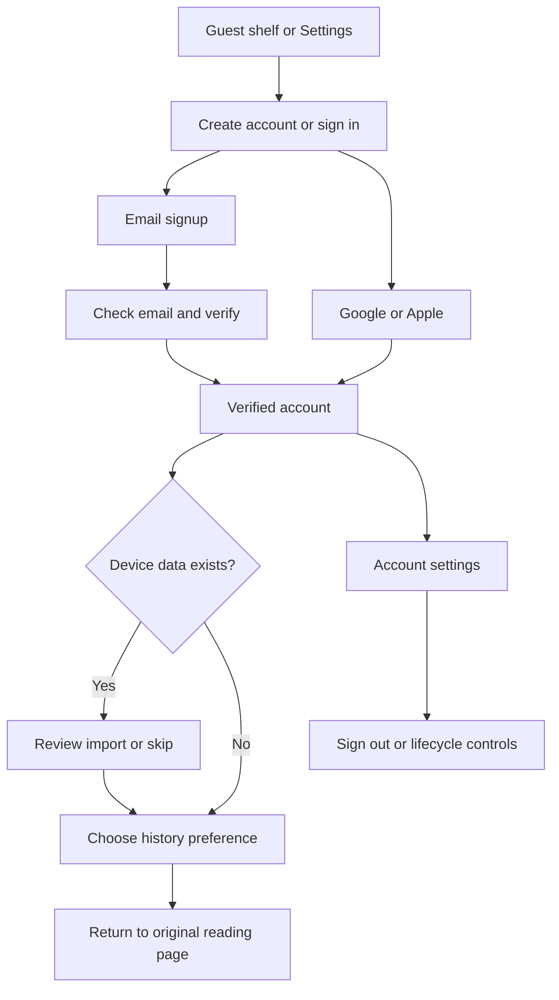

# Account UX design

Version 0.1, 2026-11-01. D02. **Document draft for R01.** These are interaction
wireframes and content contracts. Claude supplies the visual artifact after R01;
[UI_ARTIFACT.md](UI_ARTIFACT.md) records that later work. Requirements: [PRD](PRD.md).

## Navigation and structure

Keep the current reading shell, search, shelf, book and library destinations.
Settings gains an Account section before Your library. Guests see “Keep your shelf
across devices”, “Create account”, “Sign in”, and “Continue using this browser”.
Saving never forces signup or inserts an account modal into search.

Desktop auth pages use a single readable form column inside the existing shell.
Mobile uses a full-page form with Back, title, fields, primary action and alternate
methods in that order. Avoid nesting auth forms in dialogs. Account settings has
grouped sections; narrow screens stack them in the same reading order.



All journeys retain an allowlisted relative `/app/...` destination, without tokens
or arbitrary external URLs. Default is `/app/shelf`. Return to a book must preserve
its exact key. New sign-in never replays a pending destructive action automatically.

## Journey contracts

| Flow | Entry and ordered interaction | Success | Failure, cancellation and recovery |
| --- | --- | --- | --- |
| UX-01 Signup (AC-02) | Settings → Create account → private name, email, password, show-password control, privacy link → Create account | Check-email page displays submitted address, resend and change-address/start-over actions; browser shelf remains intact | Field errors adjacent to labels; generic duplicate response. A mail outage says delivery may be delayed and offers resend; no false “email delivered” claim. Loading prevents double submission. |
| UX-02 Verify (AC-02) | Email link → confirmation landing → deliberate “Verify email” | Verified session or explicit sign-in if library requires it → import offer | Expired/used link offers resend. Opening on another device verifies there; original device offers “I've verified” to recheck. Link preview alone does not authenticate. |
| UX-03 Sign in (AC-03,06) | Email/password or separate Google/Apple buttons; Forgot password and Create account links | Show account identity, then import/history choices if applicable, then safe return | Generic bad-credential error; unverified account sees resend only after appropriate proof. Provider cancelled/error returns to same page without erasing guest data. Missing provider name gets a private-name completion step. |
| UX-04 Recovery (AC-04) | Forgot password → email → neutral “If this address can receive a reset link, we'll send one” → reset link → new password | “Password updated. Sign in again”; all prior sessions revoked | Expired/used link returns to a new request. Social-only account mail explains provider login and password setup path; public response remains neutral. Never request an old password in reset flow. |
| UX-05 Guest import (AC-12) | Verified account → preview destination name/email, count of device saves, recent history count and library choices | Confirm import → acknowledged counts (added/already saved/skipped expired) → optionally remove exact imported device data | “Not now” returns to reading; offer remains in settings. History box unchecked; separate future-history choice. Overflow explains capacity and changes nothing. Failure retains snapshot, retry uses same import ID. Corrupt storage routes to existing recovery, never silent import. |
| UX-06 Reading and sync (AC-09–11,14) | Existing book Save, shelf Remove/Undo, library Select and recent-history controls | Pending label → confirmed state; another device refreshes to see result | Offline says “Couldn't save to your account. Retry when connected.” Conflicts say “Your shelf changed on another device. Refresh to try again.” Existing content can remain marked stale while authenticated; expired identity content clears. |
| UX-07 Account details (AC-08) | Settings → Account → private name; Change email | Name acknowledged inline. New email displays pending verification until confirmed; old email remains valid meanwhile | Name errors retain text. Email changes require recent auth; cancel leaves old email. Collision/expiry returns recoverable error without disclosing who owns address. |
| UX-08 Security and methods (AC-04,05,07) | Settings → Security → change/set password, linked methods, active sessions | Explicit link confirms provider; disconnect confirms remaining method; selected session disappears after revoke | Recent-auth screen uses existing password or linked provider. Provider collision recommends signing into that account; never offers email-based merge. Last-method control disabled with explanation. Failed revocation stays actionable. |
| UX-09 Sign out/switch (AC-05,14) | “Sign out” distinct from “Sign out all devices” → submit | Hide account state; restore separate guest shelf and local appearance; other tabs recheck identity | Hide private content even if request fails; show “Server sign-out could not be confirmed” with Retry and Continue as guest. No success toast. Local guest mode suppresses automatic session hydration and persists across reloads until resolved. |
| UX-10 Export/delete (AC-13) | Settings → Your data → Export JSON or Delete account → recent auth → explicit confirmation | Export downloads once. Delete acknowledgement ends session and explains cleanup/backup windows | Confirm name/email and “Delete account” button; no prechecked local-data deletion. Provider/job error after accepted deletion cannot restore access. Failure before acknowledgement offers status recheck/retry without claiming deletion. |
| UX-11 History (AC-11) | First sign-in or Settings → “Save recently viewed books to my account” off by default | Enable announces “On”; pause preserves existing list; remove/clear confirmed separately | Explain “Up to 50 books for 30 days”. Clear needs confirmation. Failed toggle returns to server value with error; old pending views do not reappear after pause/clear. |

## Text wireframes for review

```text
Create account                      Account settings
[Back to shelf]                     Account: Reader Example · reader@example.test
Keep your shelf across devices      Your name [Reader Example] [Save]
Your name     [                ]    Email     reader@example.test [Change]
Email         [                ]
Password      [            Show]    Sign-in methods
At least 15 characters              Password [Change] / [Set password]
[Create account]                    Google [Connect / Disconnect]
                                    Apple  [Connect / Disconnect]
Or continue with                    Sessions [This browser] [Other browser: Revoke]
[Google] [Apple]                    [Sign out] [Sign out all devices]
Already have an account? Sign in
Continue using this browser         Your reading data
Privacy policy                      Recently viewed [Off / On]
                                    Device shelf [Review import]
                                    [Export data] [Delete account]
```

```text
Bring this browser's books?         Clear saved books?
Destination: Reader Example         This removes 24 saved books from your account
reader@example.test                 on every device. Recent history is unchanged.
24 saved books · 8 recent books
[ ] Include recent history          [Cancel] [Clear saved books]
    Does not turn on tracking
Library: keep account library
( ) Use this browser's library      Delete account?
[Import 24 saved books] [Not now]    Reader Example · reader@example.test
                                    Access ends now; live data within 24 hours;
After success only:                 backups within 30 days. Provider cleanup may
Your books are now in your account  retry if the provider is unavailable.
Device copy remains here            [ ] Also remove the guest shelf in this browser
[Remove device copy] [Keep it]       [Cancel] [Delete account]
```

These specify hierarchy and meaning, not final visual spacing or provider-button
branding. Claude should retain the decisions and propose visual variations only
with documented differences for R02.

## Shared interaction states

- **Initial loading:** neutral shell; no flash of account A, guest shelves or
  another account while session is unresolved. Public search stays available.
- **Empty:** explain whether this is a device shelf or account shelf and offer
  search. Empty history states distinguish off, paused and enabled/no views.
- **Pending:** announce status, disable duplicate action only, keep Cancel/Back
  where safe. Tokens/passwords never appear in toasts, URLs after consumption,
  console output or fixture exports.
- **Validation:** retain safe fields, never persist password; focus error summary
  then link to invalid field. Match server errors without relying on raw messages.
- **Rate limited:** show wait guidance from Retry-After and a usable alternate
  navigation path. Avoid a rapidly updating live-region countdown.
- **Destructive actions:** name the affected scope (account/all devices versus
  this browser), use a separate confirmation, initially focus Cancel, restore
  focus on cancellation. Completion announces outcome without trapping focus.
- **Provider return:** distinguish sign-in from linking. Cancelling either keeps
  the prior authenticated state and destination; never change accounts silently.

## Accessibility and content acceptance

Use visible labels, correct `name`/`email`/`current-password`/`new-password`
autocomplete, paste and password managers. Password visibility toggles announce
state. Associate field hints/errors with inputs; status uses polite announcements,
blocking errors use an alert without repeated announcements on each render.

Dialogs trap and restore focus, close with Escape when safe, and have a labelled
title/description. A reauthentication page returns to a confirmation screen,
not directly to deletion. Touch controls target at least 44×44 CSS pixels; keyboard
focus remains visible in all lights. Respect reduced motion. Long emails, names,
book keys and translated strings wrap without horizontal scrolling at 320px.

R01 checks these journeys as documents. Claude's prototype is inspected at S22;
the implemented behavior gets keyboard, screen-reader and browser evidence at T04.
