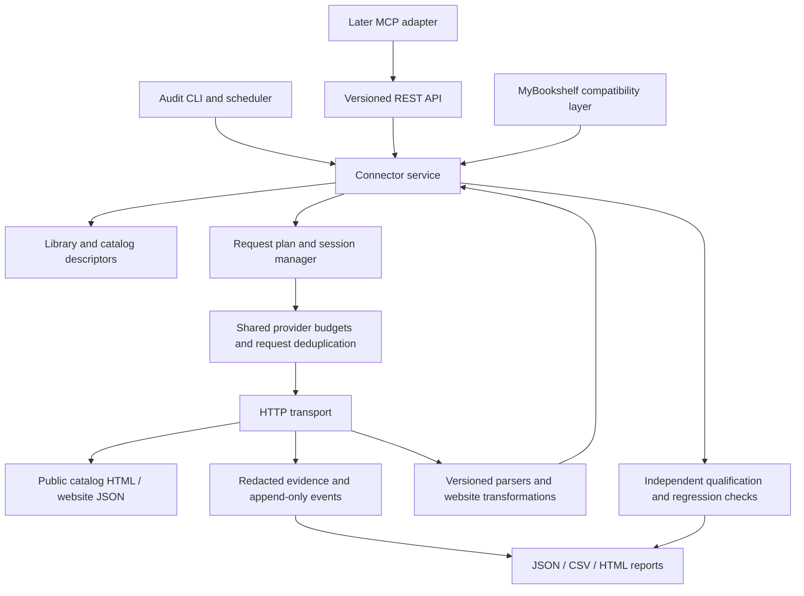

# Engineering design

## Architecture



No browser engine or browser-control fallback. The runner sends real HTTP requests. Fixtures emulate responses only in offline tests.

Use Node 22 and the existing repository modules. Proposed additions: `server/services/catalog-connectors/` for contracts, descriptors, coordinator and service; `tools/library-audit/` for CLI, scheduler, journal and reports; `testdata/library-audit/` for sanitized fixtures; `docs/research/india-library-audit/` for versioned audit snapshots. Exact files are introduced story by story, not by moving every existing provider at once.

## Reuse and migration

| Existing code | Action |
| --- | --- |
| `server/services/directory.js` | Freeze canonical IDs and aliases into audit inventories; preserve app identity |
| `server/services/providers/index.js` | Add compatibility adapters incrementally; keep alternate route identity explicit |
| `providers/http.js` | Extract/inject transport, clock, cancellation, scheduler and evidence hooks; existing queue/cache alone do not expose freshness or cross-process budgets |
| `providers/egranthalaya.js`, `indcat.js`, `koha.js` | Preserve form/scope validation; expose native totals/pages and remove silent first-ten truncation from the new contract |
| `providers/libman.js` | Replace audit-only first-ten/limited-detail assumptions with capability-driven paging and sufficient evidence selection |
| `providers/discoveryAcademic.js` and community variants | Review literal-query transformations, surrogate IDs, client-side filters and public request provenance per variant |
| `public-v2/catalogBooks.js` | Its current relevance reranking must stay outside the new native-order connector response; version/label any later app behavior change |
| `public-v2/telemetry.js` | Preserve its query-free public telemetry contract; add a separate bounded audit-event schema rather than loosening it |

Existing fixtures prove parser behavior at capture time, not current connectivity. Existing `searchLibraryBook` has a small single-book budget; it is not the qualification engine. Snapshot current behavior before each migration and keep old routes/book keys valid.

## Catalog descriptors and adapter contract

Separate **library** (institution/branch), **catalog instance** (site/index), **provider origin/budget group**, **adapter family/variant**, and **connection** (one library's route to a catalog). They are different identities. Several connections may belong to one library. One family can span many origins/countries; many institutions may share one origin.

A descriptor records stable IDs; country/region/languages/encoding/timezone; approved origin/path patterns; operator and policy evidence; member/branch codes and alias mappings; public landing link; search fields/defaults; native sort/page sizes; session behavior; result and membership paths; API/export eligibility; rate/concurrency/response limits; adapter/parser versions and fidelity status. Pin configuration and public asset/documentation hashes establishing request semantics. Updating a site version invalidates the relevant parity evidence and schedules revalidation.

Proposed adapter interface:

```text
capabilities(connection) -> search fields, filters, sort, paging and proof modes
createSession(connection, transport) -> ephemeral anonymous session
planSearch(session, searchProfile) -> bounded native HTTP request plan
parseSearch(response, searchProfile) -> ordered native records, total, scope, page
planRecord(session, recordReference) -> optional detail/holding request plan
parseRecord(response, recordReference) -> record and membership evidence
validateScope(response, connection) -> supported / unconfirmed / wrong library
```

Transport and evaluator are injected. Parsers cannot make hidden network calls. Every upstream request goes through one governor and emits a request event. Details run only if required fields/membership are missing, or a selected sentinel requires record resolution. At least one detail/link resolution is exercised during qualification when supported; a result-page proof alone does not certify the detail operation.

## Establishing website-equivalent requests

For HTML forms, read the actual form method/action, visible choices/defaults, encoding and hidden state. Submit the anonymous form with fresh state. For JSON sites, use the public request shape and display transformation established by official documentation or publicly served site code/configuration. Treat site code as evidence to inspect, not arbitrary code to execute on our server. Record the relevant selectors/JSON paths/script references and transformations in a versioned request recipe.

Use `website_native` as the default semantics. No silent query shortening, accent stripping, transliteration, normalization beyond demonstrated website behavior, alternative-field fallback or local reranking. Reject an unsupported field/filter instead of ignoring it. Preserve the submitted query separately from an effective query when the website itself transforms it, with the transformation reason. Set native defaults explicitly so comparisons remain reproducible.

If a site fetches a bounded public metadata feed and searches it locally, reproduce that algorithm only when the actual script behavior, feed version and permitted reuse are established. Otherwise keep `alternate_not_equivalent` and exclude it from the strict 20-book pass. A different official API may be useful but is not equivalent merely because it belongs to the same organization.

The independent verification path uses captured raw response rows/fields, reviewed expected native IDs and scope assertions, not the production parser's output as its own expected result. Ordered native result IDs, count semantics and visible display transformations must agree. No browser-rendered equivalence is claimed.

## Sessions, paging and identity

- Pool anonymous sessions only within compatible origin/tenant/profile boundaries. Lock stateful forms while advancing viewstate/CSRF and pagination; concurrent actions must not reuse consumed state. Discard on expiration or scope mismatch; refresh once through the normal form flow and log it.
- Separate source paging from API delivery paging. Preserve native page sizes and ordering. A larger API page may concatenate native pages only when `maxSourceRequests` and deadlines allow, and must retain boundaries/provenance. Default to one native page.
- Cursor binds connection, adapter/config version, effective query/filter/sort hash, native continuation and expiry. Never put cookies/CSRF/viewstate or raw arbitrary URLs in client tokens. Stateful sessions are stored temporarily behind opaque handles; expiry/restart produces `CURSOR_EXPIRED`, never a silent page-one replay. Stateless cursors are signed and validated.
- API results preserve native IDs (or explicitly tagged stable/replay fingerprints where no native ID exists), edition identity and rank. An audit acceptance set deduplicates copied records/known works separately. Ambiguous identity cannot create an additional accepted book.
- Membership proof must come from actual validated scope and/or explicit matching holding/institution data, not just a requested parameter. Shared response evidence may support multiple members only when it explicitly names each one. An alternate route cannot silently masquerade as the primary website.

## Efficient execution and traffic limits

First reduce requests: reuse normal session state; parse all permitted native rows; use result-page evidence when sufficient; coalesce identical in-flight requests; use provider-supported batch/detail requests only when their website semantics are known; keep reusable immutable evidence by content hash. Do not scrape unneeded detail pages or download books.

Cache key includes connection/member, literal and effective query, field, filters, locale, sort, native page, parser/config version and session-dependent scope where needed. Two branches must never share a query cache merely because they use one host. Metadata cache and observation freshness are separate: a cache hit retains its original source observation time.

Start at one in-flight request per provider budget group with a three-second minimum gap, or a stricter published limit. Use a configurable global pool initially eight independent origins, bounded by memory and observed errors. Increase per-origin concurrency only where policy allows and pilot measurements show it is safe; never assume 62 e-Granthalaya clusters are 62 independent hosts. Rate-limit groups can span related hostnames when the provider shares a quota.

Queue by eligible time and per-provider fairness, not a giant unbounded Promise list. Apply separate queue, request and total-job deadlines. Cancel actual transport on deadline; a timed-out wrapper must not leave requests running. One layer owns retries to avoid multiplication. Safe idempotent GET retries use jitter and bounded budgets; POST searches may retry only after adapter-specific replay safety/fresh form state is established. Save every attempt. Refusals open a breaker; honor Retry-After and documented recovery triggers.

Do not hold a host permit while waiting to acquire the same permit through a nested provider helper. Schedule network operations centrally; keep session locks separate. Fast providers can progress while a slow origin is cooling down.

## Files, durability and coordinator

Initial deployment unit is a single Node process with a local durable volume: connector API plus outbound coordinator and audit scheduler. A separate CLI can submit audit jobs or run this same engine locally. The first internal audit needs no hosted public endpoint. Do not treat a stateless Vercel function's memory or `/tmp` as durable global scheduler state.

Use append-only per-run JSONL journals, content-addressed sanitized response files and atomically replaced summary/cursor JSON. Events include schema version, run/job/attempt/request IDs, sequence and observation time. The single writer flushes evidence before its referencing event, then updates checkpoints. Read-only report generation can run separately against committed event offsets.

Recover by replaying committed events. Quarantine an incomplete final JSONL line, preserve it for diagnosis, verify hashes and resume unfinished jobs. A truncated response or missing evidence file never becomes a passing observation. Re-running a completed job is an explicit revalidation with a new observation ID, not double-counting. Checkpoint every ten libraries or fifteen minutes plus graceful shutdown.

Use an exclusive local lock, process command/boot identity and heartbeat; reconcile remote commit freshness before another writer starts. Do not assume a PID in a different environment is the same worker. A remote push rejection stops publication and triggers reconciliation; do not force push or discard observations. Persistence is at-least-once collection with idempotent reduction, not a claim of exactly-once network access.

Git stores sanitized configuration, plans, compact observations and checkpoint exports initially. Deduplicate unchanged bodies and shard by run/provider; do not commit a new copy of every unchanged response on every check. Preserve qualification and failure evidence; propose retention/archival changes before discarding audit proof. If measured volume outgrows Git or concurrent writers are needed, introduce a storage interface-backed archive/queue through a separate costed decision. No new database is assumed by this design.

## App, permanent API and later scaling

The API contract is permanent even when the first deployment is local/internal. Later expose the same coordinator behind a bounded REST facade. MyBookshelf and all external clients must route through that governor for opted-in connectors; no per-process/direct-provider side paths that evade quotas. Use a compatibility layer and per-connector rollout/rollback to preserve the current app contract.

Before public launch select a host with persistent state and sustained process support based on measured operating cost. Existing Vercel can remain the app facade, but full audits do not run inside interactive HTTP request handlers. If the existing environment cannot provide a durable service without new cost, keep API internal and present the hosting choice; do not quietly provision paid resources.

Public concurrent replicas require shared admission/coordinator state or explicitly partitioned provider ownership with fencing and failover; in-memory queues in many serverless instances are insufficient. This is a later scaling gate, not a hidden initial Redis requirement. File-backed single-writer operation remains appropriate until measurements show otherwise.

## Public service safeguards

Accept configured library/connection IDs only. Validate redirects, DNS resolutions and destination paths to prevent arbitrary fetches, private-network/metadata access and credential forwarding. Some legitimate India catalogs use public IP origins; support only explicitly reviewed public endpoints. Enforce body/decompression/page/deadline limits and cancel on disconnect where safe. Never disable TLS verification to make a connector pass.

Protect write/admin/audit operations separately from public search. Public API keys and quotas are unrelated to the app's reader-account work. Provider cookies, auth credentials and raw sessions are never returned. Do not expose raw traces just because a user has a request ID. Log owner-authored synthetic audit terms in the evidence store; do not persist public users' reading/search queries in audit logs. Treat upstream titles/HTML as untrusted text in reports and MCP responses.
