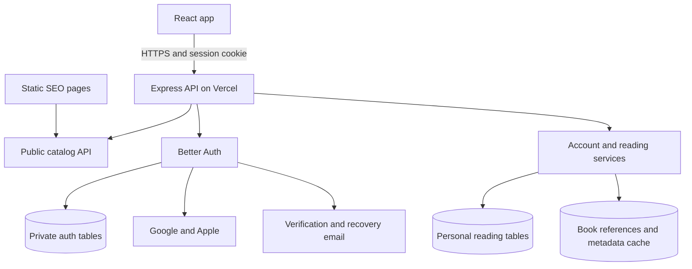

# Accounts and social reading foundation

Date: 2026-10-31. Status: architecture direction accepted for planning; PRD, UX and implementation specifications remain to be written. No authentication, infrastructure, or production changes made.

Active repository: `ddk220-light/MyBookshelf-web`. See the [delivery backlog](2026-10-31-accounts-delivery-backlog.md) and [handoff](../STATUS.md).

## Recommendation

Use **Better Auth + managed PostgreSQL**, integrated into the existing React/Vite client and Express API. Prefer Neon for the database on Vercel, with a transactional email provider for verification and recovery. Keep authentication, personal reading data, and future community features as separate modules in one application and one database initially.

Build email/password, Google, and Apple account flows; synchronize selected libraries, saved books, and recently viewed books. Preserve anonymous browsing. Add reviews, comments, follows, favorites, and custom lists in later releases using the same application user IDs and persistent book references.

**Book identity decision:** reuse Open Library work/edition identities and the application's existing ISBN and catalog-key handling. The account release needs a small reference store, not a new canonical catalog or matching service. Internal row IDs support database relationships; they do not establish that two books are the same work.

This is a recommendation, not a claim that an authentication dependency eliminates security work. Pin a supported patched release, review its advisories and generated schema during implementation, and test the configured flows. No provider account, paid subscription, or database was provisioned during planning.

## Current app findings

- `server/index.js` and `server/vercel.js` use `createAnonymousApp`. `server/anonymousApp.js` exposes `/api/v2` and health; other API routes return `410`. New account routes must be mounted deliberately before that fallback.
- `client/src/v2/localState.ts` persists `selectedLibraryId`, `savedBooks`, and `recentBooks` in `mybookshelf.anonymous-web.v1`. Current limits are 100 saved books and 50 recent books. Saved entries reuse the recent-book shape, including `viewedAt`; the new model should distinguish saving from viewing.
- `client/src/v2/context.tsx` owns local reading state and is the integration point for a storage abstraction. `readerState.ts` also stores library summaries and availability caches; account changes must clear all account-derived caches, not just the shelf array.
- `PublicBook` has a provider `bookKey`, optional ISBN, and optional `workId`. `server/services/workDiscovery.js` already uses Open Library work IDs for search and follows ISBN edition-to-work relationships. `server/services/isbn.js` already normalizes ISBN-10/13. Reuse these components; their coverage and source assertions need validation, not a replacement resolver. See `docs/work-aware-search.md`.
- Historical SQLite library-card/PIN authentication is retired and absent from this repository. Do not recreate its credential replay, indefinite sessions, or first-user data adoption; the current account proposal starts from the anonymous web app.
- This web repository is the source of truth. Add new server modules, migrations, tests, dependencies and documentation here directly; no private-repository export step is required. Repository code remains AGPL-3.0-only with third-party notices retained.

## Open-source options researched

| Option | Repository / license | Fit and tradeoff |
| --- | --- | --- |
| **Better Auth — recommended** | [better-auth/better-auth](https://github.com/better-auth/better-auth), MIT | Runs in the existing Node application; React client, Express integration, credential and social authentication. We control the data and match the current UI. We own configuration, email delivery, updates, and operations. |
| Supabase Auth | [supabase/auth](https://github.com/supabase/auth), MIT | Strong alternative when choosing managed Auth and Postgres together. Supports password and social login, with database RLS integration. Adopting its integrated platform could reduce operational work, while requiring a different session/access integration. Self-hosting its full stack adds operations. |
| SuperTokens | [supertokens/supertokens-core](https://github.com/supertokens/supertokens-core), Apache-2.0 for core outside enterprise portions | Supports credential/social recipes and session handling. Requires its core service or hosted offering alongside the app. Review enterprise-feature boundaries before selecting account-linking or other advanced capabilities. More infrastructure than this app presently needs. |

Use the maintained library as a dependency rather than forking an entire demo application. Better Auth's MIT notice must be retained; adding it does not change MyBookshelf's own AGPL license. Hosting and email have separate operating costs even when the library is free.

Sources: [Express integration](https://better-auth.com/docs/integrations/express), [credential flows](https://better-auth.com/docs/authentication/email-password), [Supabase Auth overview](https://supabase.com/docs/guides/auth), [SuperTokens authentication](https://supertokens.com/docs).

## Components and boundaries

The three database groups are logical boundaries within one Postgres deployment. Use separate database roles for migrations, authentication, and application access where practical. Keep all database connections on the server; the browser receives narrowly defined API responses.

- **Client:** account screens, auth state, existing shelf UI, and a guest/account repository interface. Keep the current design system.
- **Auth module:** Better Auth configuration, provider callbacks, sessions, verification, password lifecycle, and linking login methods. Mount `/api/auth/*` before Express JSON parsing and the retired-route handler, using the Express 4 handler syntax until the server is upgraded.
- **Account/reading module:** private profile settings, library selection, saved books, recent history, import, export, deletion. Suggested namespace: `/api/account/*`.
- **Catalog module:** existing `/api/v2` discovery, metadata and availability. It remains usable without an account. A database or auth outage should not take down public browsing.
- **Database:** managed Postgres, pooled runtime connections, migrations run as a separate release step. Drizzle is a reasonable typed schema/migration layer; generate the auth tables from the chosen Better Auth version rather than hand-maintaining an approximation. Validate transaction and adapter behavior in the implementation spike.
- **Operational tasks:** reliable email dispatch/retries, expired-token/history cleanup, account deletion, and backup checks. No social feed service, search cluster, graph database, or microservice split is needed now.

Neon supports [pooled connections](https://neon.com/docs/connect/connection-pooling). Select a database plan/region with adequate restore retention and keep it near the Vercel API region. A local SQLite file inside a Vercel deployment is not suitable as the durable multi-user database.

## Account behavior

| Flow | Proposed behavior |
| --- | --- |
| Email signup | Ask for name, email, password. Treat name as a chosen display name, with no legal-name requirement. Send email verification before enabling account sync. Keep the guest shelf available while verification is pending. |
| Social signup | Google or Apple validates identity; obtain the available name and email and ask for a missing name. Do not require a separate password from social-only users. Allow adding one later through a verified recovery/setup flow. |
| Sign in | Email/password or a linked provider; return to a validated in-app destination. Preserve the book or shelf the user was viewing. |
| Forgot password | Generic acknowledgement, short-lived single-use recovery link, choose a new password, invalidate existing sessions, and require sign-in again. Never send or reveal an old password. |
| Change password/email | Require recent authentication; verify the new email before changing it, notify the old email, and prevent duplicate account ownership. |
| Linked accounts | Explicitly link Google/Apple from account settings after recent authentication. Disable implicit same-email linking. An email match is not a sufficient account merge decision. |
| Sign out | Revoke the current server session and clear its cookie and account-derived browser state. Provide “Sign out all devices” separately. Preserve cloud data. |
| Delete/export | Export personal data without credentials/tokens. Require recent authentication to delete; revoke sessions immediately and remove private data via a retryable cleanup job. |

For linking, configure `disableImplicitLinking: true`. Apple relay emails can differ from the email already on an account; support an explicit authenticated linking flow that proves control of both identities. Do not enable broad trust overrides for unverified provider email. Prevent unlinking the last usable login method. If a person already created two separate accounts, defer an account-merge feature rather than moving shelves based on matching names or emails.

Better Auth documents [account linking and user management](https://better-auth.com/docs/concepts/users-accounts). Google needs its own [OAuth client ID, secret and registered callbacks](https://better-auth.com/docs/authentication/google); the existing Google Books API key cannot serve that purpose.

## Data model: build in the first account release

The following is a conceptual model, not executable migrations. All application IDs are stable opaque IDs, all timestamps are UTC, and relationship fields have real foreign keys wherever their targets live in Postgres.

| Entity | Important fields and constraints |
| --- | --- |
| Auth-owned user/account/session/verification tables | Generated by Better Auth. Store email verification state, credential hashes, external provider identity, session expiry, and verification/reset state. Enforce uniqueness of provider plus provider subject. Never return raw auth rows through public APIs. |
| `app_users` | `id` UUID PK, `auth_user_id` unique FK, lifecycle status, created/updated timestamps. One application identity independent of the choice of login provider. Create idempotently on first successful verified sign-in; foreign-key cleanup must cover partial signup. |
| `user_settings` | `user_id` PK/FK, locale, history-enabled setting, history generation, version. Appearance settings may stay device-local initially. No public exposure of location or library choices. |
| `user_libraries` | Composite PK `(user_id, library_id)`, `is_selected`, added/updated timestamps. Partial unique index permits at most one selected library per user. `library_id` remains the stable directory ID; validate against the existing directory service. Keep multiple rows possible even if v1 only exposes one selection. |
| `book_refs` | `id` UUID PK, unique existing `book_key`, source/kind, source record ID, optional Open Library work and edition IDs, validated ISBN-13, minimal permitted metadata, provenance and observed time. A local record points to an existing identity; it is not a newly asserted global work. Preserve library namespace for catalog records. |
| `user_books` | Composite PK `(user_id, book_ref_id)`, `saved_at`, created/updated timestamps and version. Saving the same reference twice is idempotent. Preserve the exact edition/catalog reference the user saved; separate `saved_at` from viewing time. |
| `recent_book_views` | Composite PK `(user_id, book_ref_id)`, `last_viewed_at`. One recent entry per reference, not an indefinite stream of every click. Index `(user_id, last_viewed_at DESC)`. Presentation may group positively linked Open Library works while retaining the individual references. |
| `guest_imports` | `user_id`, random import ID, payload hash, completion state/result. Unique `(user_id, import_id)`; same key with different payload is rejected. Makes a retried import safe. |

Better Auth also needs a shared rate-limit store. Start with its supported database-backed store; add Redis when traffic justifies it. Minimal security-event records and retryable deletion/email job state are operational data, with short retention and no secrets in payload logs.

### Reuse established book identities

| Existing system | What it identifies | Proposed use |
| --- | --- | --- |
| [Open Library](https://openlibrary.org/dev/docs/api/books) | Work (`OL…W`) and edition (`OL…M`), with links between them | Preferred external work identity. Use returned relationships, retain their source, and keep the user's original edition/reference. Already integrated. |
| [ISBN](https://www.isbn-international.org/index.php/node/10) | A publication's particular edition/product format | Normalize using the existing utility; use existing ISBN lookup to discover an Open Library edition/work when available. It cannot alone group all translations/formats of a work. |
| [Google Books volume ID](https://developers.google.com/books/docs/v1/reference/volumes) | A record within Google Books | Keep as a source identifier and metadata fallback. Its public Volume API does not provide a universal work identifier that replaces Open Library's work relationship. |
| [BookBrainz](https://bookbrainz.org/develop) | Linked bibliographic entities with its own IDs | Potential later source. Its developer page currently describes the API as alpha. Evaluate coverage and entity semantics before adding a second authority. Core metadata is [CC0](https://bookbrainz.org/licensing). |
| [BookWyrm](https://github.com/bookwyrm-social/bookwyrm) | An existing open-source social-reading application | Reference for later shelves/reviews/privacy design. Its [book import workflow](https://docs.joinbookwyrm.com/adding-books.html) prefers existing catalogs, including Open Library and Inventaire. It is a whole application, not a drop-in Node identity package. |

For accounts now:

1. Preserve the existing `bookKey` and obtain a stable `book_refs.id` by upsert. Saves do not wait for a new metadata lookup if an accepted reference is already known.
2. Retain Open Library work and edition IDs already obtained from provider responses. For an exact ISBN, reuse the existing lookup and store the provider's relationship when unambiguous. Multiple works, anthologies, conflicting ISBNs and malformed results must remain unresolved rather than taking the first candidate for social grouping. The existing lookup's first-work assumption needs review before its output is used for this stronger purpose.
3. If no reliable work match is available, keep the ISBN, Google volume, or library record as an unresolved reference. Users can still save and view it. Do not invent a work grouping or run fuzzy title/author merging.
4. Permit several saved references to point to one known work. Preserve edition choices. Cross-source duplicates may remain when relationships are unknown; that is preferable to joining different books incorrectly. This first release is not a universal deduplication project.

When public reviews arrive, introduce a small `works` table keyed internally with a unique Open Library work ID where known, and link existing `book_refs` to it. Reviews and work-level lists can reference that row; edition-specific comments/availability retain their original references. For books still lacking a work match, use a deliberate unresolved/review flow instead of manufacturing equivalence. Stable local IDs keep personal content attached while a verified upstream redirect or correction is reconciled. Defer a merge editor, broad cross-provider matching and a full metadata mirror until evidence justifies them.

Before locking the social schema, validate a bounded representative sample from the Indian, US and Japanese catalogs: regional-language books, older/no-ISBN records, translations, audiobooks, revised textbooks, collections and similarly named books. Measure valid work-link coverage and incorrect groupings. This planning pass reviewed documentation and existing implementation; it did not establish a coverage percentage for those catalogs.

Store only permitted metadata, with provenance and refresh dates. Open Library's [API guidance](https://openlibrary.org/developers/api) supports cached human-driven lookups, not bulk harvesting or a high-traffic third-party backend. Use a shared request budget/cache across instances, identify the application properly, and consider official data dumps or a supported data arrangement if volume grows. Saved shelves must render during an upstream outage. Book-cover rights and source-specific data terms still apply. Do not copy Goodreads reviews into our review tables.

## Privacy, credentials and authorization

- Use the auth library's salted, slow password hashing; Better Auth currently documents scrypt. Never store plaintext or reversibly encrypted application passwords, send them in email, or reuse the old library-PIN mechanism. Proposed password policy: long passphrases, 15–128 characters, paste/password-manager support, no forced symbol rules; add a breached-password check through a supported integration.
- Use HTTPS and host-scoped Secure, HttpOnly session cookies. Use SameSite settings supported by each flow and test Apple's cross-site POST callback. No auth tokens in localStorage. Leave session cookie caching disabled initially so revocation is checked against the server.
- Start with seven-day rolling sessions and daily renewal; require authentication within the last five minutes for sensitive changes. A rolling session is not an absolute seven-day lifetime. Password reset and “sign out everywhere” revoke all sessions; this must work across API instances. See [session management](https://better-auth.com/docs/concepts/session-management).
- Validate session and ownership on every private API operation. Derive `user_id` from the server session, never a client-supplied body field. Use parameterized queries and explicit response-field allowlists.
- Add Postgres RLS for private reading tables as defense in depth. Set the authenticated application user ID **transaction-locally** after server validation; never leave identity on a reused pooled connection. Runtime roles must not bypass the policies. Test with the actual runtime role, including owner/bypass behavior, and keep migrations under a different role. RLS does not replace API authorization.
- Protect custom mutations with origin/CSRF validation as well as cookies; Better Auth only protects its own handlers. Use exact production/staging trusted origins and callback destinations. Never trust every `*.vercel.app` deployment.
- Apply shared rate limits to login, signup, reset, resend, linking and expensive private endpoints. Use IP and account-scoped abuse controls without permanent account lockouts. Check proxy-header handling so clients cannot choose the rate-limit identity. Better Auth's [default memory store is not shared across serverless instances](https://better-auth.com/docs/concepts/rate-limit).
- Use encrypted database storage and backups with least-privilege access, audited administration, tested restore procedures and a documented retention window. These controls are not end-to-end encryption: the application must be able to read data it serves.
- Keep OAuth secrets, auth signing secrets, database credentials, mail keys and any token-encryption keys in server-side environment/secret storage, separated across production, staging and development. Never in `VITE_*`, browser bundles or the public repo. Do not persist provider access/refresh tokens unless needed; encrypt any that must be retained using a supported configuration/hook strategy validated against the selected version. Do not assume the auth library encrypts every token automatically.
- Never log passwords, cookies, reset links, OAuth tokens, full auth request bodies or private reading contents. Keep minimal security events with bounded retention. Require MFA for infrastructure/admin accounts; user MFA/passkeys can follow later.
- Keep shelves, library selections and view history private. Proposed recent history: newest 50 distinct book references within 30 days, with pause, individual remove and clear-all controls. Do not publish this history in a future activity feed.
- Account deletion removes private reading rows, credentials and provider links; handle provider revocation where required. Disclose backup expiry and prevent a restore from reactivating deleted accounts. Define public-content deletion before launching social features.

## Guest-to-account sync and consistency

Keep guest browsing and local shelves. On first verified sign-in, show “Add the books saved on this device to your account,” with a count and separate choice for recent history. Device data may belong to another person; do not upload it silently.

The server validates references, unions saved books by their accepted source keys, and never overwrites an existing account shelf with a whole browser JSON document. It must not require successful work matching to import a valid existing save. A selected library imports automatically only when the account has no selection; otherwise preserve the account choice or let the user choose. Use `guest_imports` and a transaction for bounded imports. Invalid entries are reported without losing the original local snapshot. Clear the imported guest snapshot only after successful acknowledgement and the chosen shared-device behavior is applied.

While signed in, Postgres is authoritative. Use idempotent per-book save/remove operations and versioned settings updates; no blanket last-writer-wins replacement of the shelf. Optimistic UI must roll back or clearly show failed saves. Page large shelves with a cursor; the anonymous 100-book limit need not become an account storage design limit.

Keep v1 signed-in caching in memory and avoid an offline mutation queue. Abort pending requests and clear query caches on sign-out/account switch; broadcast the change to other tabs. Ignore late responses from a previous identity. A failed/offline sign-out must not claim server revocation succeeded. Guest state and account state have separate namespaces and must never be implicitly mixed. History writes include a generation value so a clear-history operation can reject stale pending writes.

## Later additions: schema direction, not first-release scope

| Feature | Proposed tables / rules |
| --- | --- |
| Public identity | `profiles(user_id, handle, display_name, bio, avatar, visibility)`. Unique normalized handle; explicit opt-in to public identity. Never derive a public URL from email or automatically publish the signup name. |
| Reading status and favorites | Add `user_work_state(user_id, work_id, status, is_favorite)` once work grouping is available, with references to the editions read. A save is not a declaration that a book was read or liked. Add `reading_sessions` later for rereads and start/finish dates. Removing a save must not delete a review, favorite or reading record. |
| Custom reading lists | `reading_lists(id, owner_id, title, visibility)` and `reading_list_items(list_id, work_id, position, added_at)`, unique membership. Private by default. Add collaborators only when needed. |
| Ratings and reviews | `reviews(id, author_id, work_id, edition_ref_id?, rating?, body, spoiler, visibility, moderation_status, timestamps)`. An optional edition reference points to `book_refs` and must link to the same work. Initially one current review per author/work, rating bounds checked in DB. Rating aggregates include only eligible visible reviews. Keep imported external ratings separate. |
| Comments | `review_comments(id, review_id, author_id, parent_id?, body, moderation_status, timestamps)`. Enforce that a reply's parent belongs to the same review. Start with limited nesting. |
| Follows | `user_follows(follower_id, followed_id, status, created_at)`, unique pair, no self-follow. Pending requests support private profiles. |
| Blocking and reporting | `user_blocks`, `content_reports`, and moderation actions. Ship block/report/rate-limit/moderation controls alongside the first public interaction feature. Blocking must be enforced in reads, writes and feeds. |
| Activity and notifications | Transactional `outbox_events`, notifications and read markers. Publish only explicit allowed activity, recheck visibility/blocks when delivering or displaying it, and exclude private view history. Start with indexed SQL; queues/feed infrastructure can expand later. |

Before publishing community content, decide visibility rules, abuse reporting/appeals, content deletion/tombstones, and whether public profiles/reviews should be indexed. Keep all account screens and private endpoints noindex and private responses `Cache-Control: private, no-store`; no private records in sitemaps or shared CDN caches. Existing SEO pages stay public and independent of login.

## Work packages and verification

1. **Integration spike and infrastructure specification.** Pin a patched Better Auth version; verify ESM/Express 4 handling, database adapter transactions, password-hash resource use and Vercel routing. Choose region, restore retention and email provider. Establish a stable staging URL with separate database/OAuth credentials. Keep the web repository, CI and deployment inputs self-contained. Do not connect previews to production account data.
2. **Identity and lifecycle.** Schema/migrations, mail delivery, signup/verification/sign-in/recovery/sign-out, session settings, Google, Apple, linking and account deletion/export. Implement pages `/app/sign-up`, `/app/sign-in`, `/app/verify-email`, `/app/forgot-password`, `/app/reset-password`, and `/app/settings/account`. Style both desktop and mobile with the existing components.
3. **Private reading sync.** Persist existing book references, reuse available Open Library links, add owner-scoped APIs/RLS, library selection, saved books, recent history, guest import, failure states and account-switch isolation. Replace direct persistence calls with guest/account repository implementations. No new work-matching engine is required for account launch.
4. **Release validation.** Test actual email delivery and real Google/Apple redirects on staging, including mobile Safari. Test two independent users, recovery token expiry/replay, duplicate signup, login linking collisions, Apple relay email, last-method unlink protection, CSRF and redirect rejection, distributed rate limits, sign-out across tabs/devices, concurrent saves/removes, failed import retry, deletion and backup restore. Retain SEO and anonymous-browser regression checks.
5. **Future community releases.** Review BookWyrm's implementation and validate external work-link coverage before finalizing social tables. Start with profiles, reading statuses/favorites and private lists; then reviews and moderation; then comments/follows/notifications. Add public visibility only through explicit user actions.

Acceptance for the first account release: a user signs up, verifies, selects a library and saves/views books on device A; signs in on device B and sees the same account data; resets a password and invalidates old sessions; signs out without exposing their shelf to the next user; a second account cannot read or change the first account's data. Social sign-in methods must reach the same account only through the intended linking rules.

## External setup still needed

- Managed Postgres project, region, pooled runtime URL, migration credentials and restore policy.
- Transactional email provider and authenticated sending domain (SPF/DKIM/DMARC); verification/reset templates and bounce/error monitoring. Sending real messages is a future implementation step, not part of this planning work.
- Google OAuth web client and consent-screen configuration for production and stable staging. Request only identity/email/profile permissions.
- Apple Developer access, a Sign in with Apple enabled primary App ID, web Services ID, registered domains/callbacks, Team ID, Key ID and signing key. Apple's [web setup requires association with a primary App ID](https://developer.apple.com/help/account/capabilities/configure-sign-in-with-apple-for-the-web/). Confirm the existing native app registration can be used; web-only eligibility/setup is a real prerequisite.
- Apple client-secret renewal before its maximum six-month expiry; handle missing name on subsequent sign-ins. Configure [Apple private email relay](https://developer.apple.com/help/account/capabilities/configure-private-email-relay-service/) so recovery mail can reach relay addresses. Reference: [Better Auth Apple integration](https://better-auth.com/docs/authentication/apple).
- Separate production/staging auth secrets and exact URLs, privacy notice updated for account storage/history, and an operational owner for auth updates, email failures, backups and deletion jobs.

No user secrets need to be pasted into chat. These are setup requirements for implementation; they do not prevent reviewing this architecture now.
