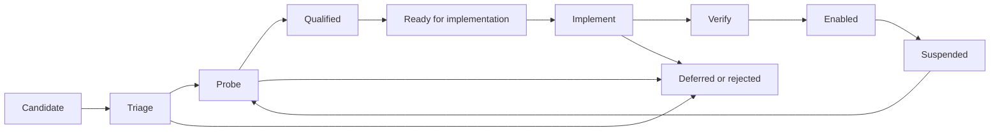

# Executing the free-knowledge expansion

Proposed operating plan, 2026-11-05. Implements the direction in the
[expansion plan](EXPANSION_PLAN.md) and its six category playbooks. This document
sets a workflow; it does not start scheduled jobs or claim newly enabled sources.

The owner subsequently authorized continued research and selected a
[Git-tracked JSON registry](registry/README.md) instead of a SQL database.
Its [goal and continuation cursor](registry/goal.json) record that work.
Ten stored retrieval examples are an additional research checkpoint, not a
replacement for the full qualification gates below.

## Recommendation: batch the research, limit active engineering, release often

Use a rolling pipeline with two overlapping workstreams: **source research** and
**product delivery**. Research several candidates together; select a small group
that shares a supported retrieval pattern; implement one connector family at a
time, with independently verified mappings for each origin. Ship a ready source
without waiting for every candidate in its research batch.

| Approach | Useful part | Limitation | Decision |
| --- | --- | --- | --- |
| Fixed number of sources every day | Creates a regular research habit | An easy catalog and a complex land-record service take very different effort; pressure to hit a count can reward superficial checks | Use research-session ranges and time budgets, never a daily activation quota |
| Finish one source completely before considering another | Keeps ownership and acceptance clear | A missing feed, restrictive terms or unavailable key can stop all progress; repeated one-off integrations miss shared patterns | Keep one active engineering family, with alternative qualified origins available |
| Research all categories before implementing anything | Gives broad coverage visibility | Delays learning from real users, operating costs and deployed source behavior | Survey incrementally and begin delivery when the first useful source passes its gates |
| Rolling small batches | Combines comparison, reusable engineering and frequent usable output | Requires a shared register and explicit limits on unfinished work | Recommended workflow |

The 300 candidate memberships and 60 distinct deep reviews in the master plan
are **cumulative first-program limits**, not an upfront research assignment.
Discovery, qualification, implementation and maintenance overlap. Reaching 100
means retaining useful, searchable coverage, not accumulating unchecked URLs.

## 1. Work queue and state transitions

Use the existing Git repository for the research register, evidence and source
manifest. Use the existing GitHub project for selected implementation stories.
Do not create one GitHub issue for every raw lead or provision a hosted database.

Transitions are evidence-based. If a permission or API assumption fails during
implementation, revise its research record; do not keep calling it qualified
under the disproved route. A deferred source can re-enter when its stated trigger
changes. Suspended sources lose their healthy-enabled designation until repaired.

| State | Required result before moving forward |
| --- | --- |
| Candidate | Canonical operator/domain, discovery link, intended content/industry/public-record coverage; duplicate check |
| Triaged | Plausible free content, supported retrieval route to inspect, documented terms/cost leads, relevance to an identified coverage gap |
| Probed | Reproducible requests/import sample, real native records and actual destinations, query capability and access observations |
| Qualified | All mandatory gates in the master plan pass for the declared subset; evidence date, scope, limits and maintainer recorded |
| Ready | Selected for the next small delivery batch, dependencies and credentials resolved, benchmark and source contract agreed; new UI requirements reviewed where needed |
| Implementing | One bounded story with source mapping, retrieval, access handling, fixtures and refresh behavior |
| Verifying | Adapter/API checks, real source observations and appropriate hosted/browser journeys pass; rollback and operations record prepared |
| Enabled | Released source is reachable in its declared product flow; exact release and live proof recorded |
| Deferred/rejected/suspended | Concrete reason, affected capability, next action or reconsideration trigger; no misleading positive access claim |

Retain origin IDs independently from connector IDs, category memberships and
industry tags. For example, an aggregator connector can expose several publishers,
but each claimed origin still needs evidence of actual coverage and access.

## 2. Capacity and limits on work in progress

Start with these defaults for one lead implementer; calibrate after two cycles:

| Queue | Initial limit | Why |
| --- | --- | --- |
| Newly selected triage batch | 15–20 unique origins | Enough alternatives to compare without opening a huge active backlog |
| Deep probes in progress | Four origins at once | Keeps incomplete permission/access questions manageable |
| Qualified and selected for delivery | Three to five origins | Leaves alternatives if one stalls; revalidate evidence before use |
| Active engineering | One connector family and at most two origin mappings concurrently | Limits overlapping edits and unfinished integrations |
| Final verification/release | One small batch | Makes failures attributable and rollback clear |

Raw leads can stay in the register without becoming active work. If the ready
queue is full, focus on delivery or a specific underrepresented category rather
than continuing to fill it. If it is empty, shift a session into qualification.

On a **research-focused session**, a starting range is 8–12 quick triages or
1–3 deep probes, depending on complexity. These are alternatives within the
available work budget, not additive daily requirements. Coding and release
sessions have no source-discovery quota. Track usable output and elapsed effort.

Use short decision timeboxes:

- **Triage:** around 10–15 minutes per origin to identify a plausible route and
  obvious exclusions. Missing evidence means unproven, not approved.
- **Initial deep probe:** around 30–90 minutes. A promising unresolved case can
  receive one explicitly scoped 2–4-hour technical spike with a question and exit
  criterion. Time spent does not relax qualification requirements.
- **External dependency:** move to deferred with a trigger such as published API
  documentation, an available free key, clarified permission or a scheduled
  review date. Do not retry it every day or hold the release for it.

Routine implementation decisions stay with the implementer. Owner input is only
needed for a real product decision or external action requiring it, such as new
costs, source outreach or a newly designed interaction—not for every source.

## 3. A practical five-session delivery cycle

A cycle is approximately a working week when capacity permits. It is not a
promise of unattended work every calendar day. New connector families may span
multiple cycles; existing mappings may move faster.

| Session | Primary work | Reviewable output |
| --- | --- | --- |
| 1 — Select and screen | Check existing-source health, choose a theme, screen 15–20 queued candidates; split this across sessions if time requires | Shortlist of four to six, duplicate decisions, clear rejected/deferred reasons |
| 2 — Prove the useful routes | Deep-review a small subset; obtain real results, validate access/terms and benchmark relevance | Qualified records with measured scope; choose one retrieval family and initial origins |
| 3–4 — Build and verify continuously | Expand concrete tasks for selected stories, implement the first mapping, then another supported by the same pattern; write meaningful failure/access tests | Small PRs, reproducible source probes, working preview; no untested bulk enabling |
| 5 — Release and learn | Complete end-to-end verification, release the ready subset, check production and operating evidence | Verified live coverage, release record, measured effort and next batch recommendation |

Keep a modest research queue running while delivery proceeds. Delegated
researchers can inspect independent categories from the playbooks and return
evidence-backed recommendations. The lead reconciles identities, permissions,
shared quotas and priority. Parallel work is useful for discovery and independent
tests; additional agents do not multiply provider rate limits. Give code workers
non-overlapping files/worktrees and keep shared connector changes coordinated.

Plan releases in **small batches of up to three to five ready origins**. One
well-tested source can be released on its own; an unfinished neighbor stays off.
There is no minimum weekly activation count. Repeat checks only when changes,
expired observations or failures justify them; documentation-only edits need
documentation checks rather than the complete application suite.

## 4. Choose the next batch by useful coverage and shared implementation

Apply the master plan's mandatory gates first, then its priority weights. Compare
incremental content/language/local coverage, query/access quality, maintenance
burden and implementation effort. A large catalog consisting mostly of already
available records can be less useful than a small regional-language collection.

Select a delivery theme, not an arbitrary bundle of unrelated websites:

- **Book/catalog theme:** an official reusable book export and additional origins
  demonstrably covered by it. Reuse the current book search/detail/shelf flow.
- **Industry guidance theme:** agricultural extension or construction/manufacturing
  training catalogs that share document/learning-resource mappings and useful
  task metadata. Implement cross-cutting tags with evidence for each assignment.
- **Public-document theme:** government reports, acts or civic records with a
  supported document API/export and explicit jurisdiction/version handling.
- **Geospatial theme:** one supported catalog/native query pattern, first a US
  case and an India case when both qualify; distinguish map discovery from
  feature/parcel lookup rather than pretending all services offer both.

An index with broad coverage can be valuable early. Verify source attribution
for each underlying origin before counting it. Generalizing a connector is
justified by a second qualified use case; avoid building a universal connector
framework before seeing those cases.

Keep breadth visible during selection. Over the first two cycles, aim to assess
at least one candidate from each of the six playbooks, with both US and India
public-information candidates. Record every category/industry not yet sampled.
Reserve about one fifth of ongoing research capacity for neglected categories or
languages so easy English-language paper APIs do not consume the whole program.
This is a research allocation; unsuitable sources do not get a lower admission bar.

## 5. Suggested opening sequence

These are conditional delivery waves. The source examples are candidates from the
research playbooks, not promises that their APIs or permissions already pass.

| Wave | Work to reach and expand into tasks | Exit / effect on next wave |
| --- | --- | --- |
| 0 — Establish the working baseline | Recheck currently enabled source behavior and freshness; inspect existing reviewed-refresh failure, including StoryWeaver; define source register and a small repeatable benchmark | Existing problems have concrete repair/defer decisions. Fix any shared blocker relevant to a selected release; an isolated source failure does not stop unrelated work |
| 1 — First useful book expansion | Compare two or three likely reusable catalogs, such as the documented DOAB/OAPEN route and an India-focused book/textbook candidate; select the first qualified route | Ship a working, bounded book-search expansion with fresh evidence and a repeatable refresh path. A single source is a valid first release |
| 2 — Repeatability and industry relevance | Prove reuse with another qualified origin; add agriculture/construction/manufacturing/logistics guidance where current content kinds fit | Shared mapping proves useful; task/industry metadata and source tests work without losing native identities. Review any new browse/filter design before implementing it |
| 3 — Public documents and maps | Qualify US/India law/civic/property/geology candidates in parallel with earlier waves; design and deliver the first supported record/map capability | A reader can perform the declared query and open the official result; unsupported jurisdiction/mode is explicit. Record discovery and feature lookup have separate acceptance tests |
| 4 — Wider formats and sustained expansion | Add audio, reference entries, archival objects and other cohorts as their retrieval and presentation contracts become ready | Maintain a stream of tested releases while advancing each category/industry toward its next qualification milestone |

Research for Wave 3 starts during Wave 1; US/India public records and maps should
not disappear behind the easier book work. Preserve the twelve-origin US/India
public-information allocation inside the overall 60-review pilot. The full
300-membership survey and 60-review allowance can be spread across several cycles.

The initial ten deep-review slots should mix approximately three book/children's
origins, two India-focused industry/learning origins, two public-information
origins (one US, one India), and one each in audio, scholarly research, and
reference/culture/media. Apply overlap and availability honestly; use the result
to revise effort estimates, not to infer that all categories have been qualified.

Refresh is part of each source's delivery. Establish independent import validation
and failure reporting where needed so one source's review failure does not erase
valid results elsewhere. Never advance observation timestamps to make an expired
source appear fresh. If the existing refresh policy is too costly for a proposed
catalog, resolve that operational question before enabling it.

## 6. Stories to expand when they are reached

Use a batch-level issue linking the selected source records. Create the specific
stories below only for the next active batch. A shared connector can have one
engineering story, with separate origin evidence/mapping acceptance; avoid
hundreds of empty source issues or a single enormous release PR.

| Story | Concrete tasks | Done when |
| --- | --- | --- |
| Source qualification | Identify operator/duplicates, inspect current terms/free limits, run known-item and topical or structured-query probes, check actual destinations, complete review record | Declared subset and query modes pass the master gates; exclusions and expiry documented |
| Retrieval and mapping | Define allowed endpoint/import route, native identities, paging, cancellation, limits, language/access mapping and origin attribution; implement representative fixtures | Real sample works; malformed/partial/restricted/timeout/limit cases are handled correctly; no paid fallback |
| Search integration | Expose the selected source and supported intent; route queries, preserve pagination and detail resolution, show coverage and unavailable states | Search and exact item resolution work without hidden source switching or misleading global-coverage claims |
| New content/interaction design, when needed | Write concise product, UI and engineering notes; produce an artifact for new industry browsing, record input or map/media result representation; obtain the owner's review of that concrete artifact | Approved behavior and fields are clear. Existing approved book flows can continue without waiting for unrelated new UI |
| End-to-end release | Test API and browser search → detail → official destination → save/reload where applicable; inspect phone/desktop and reading lights; deploy checked code and verify canonical production under existing authorization | Actual release/source evidence and rollback are recorded; the working scope is enabled |
| Operations | Define refresh/deletion behavior, source owner, review cadence, free-capacity checks and suspension conditions; prove the applicable refresh path | The source can stay truthful after launch, including stale/removed records and source outages |

Every selected source story names: user query/use case, expected native item,
content/industry/jurisdiction scope, connector dependency, free-access class,
source-specific acceptance, operating cost and owner. Track **qualified** and
**enabled** separately; a code merge alone does not establish either current
availability or complete catalog coverage.

For public records/maps, include native parcel/document/layer identity, authority,
CRS/extent/scale and date semantics as applicable. For industry guidance, include
occupation/task, model or process, revision and jurisdiction. The
[review template](SOURCE_REVIEW_TEMPLATE.md) already contains these fields.

## 7. Verification and release rules

1. **At qualification:** use the master benchmark and each playbook's specific
   tests. A genuine machine query/import plus usable destination is required;
   documentation and an HTTP 200 alone do not pass.
2. **During implementation:** test the adapter's contract and meaningful failure,
   identity, access and pagination behavior. Use fixtures for outages/429s and
   restricted examples; respect current provider limits for actual source probes.
3. **Before release:** run checks appropriate to the change plus repository release
   requirements, verify an enabled hosted preview and inspect the relevant UI.
   New interaction designs follow their concrete review story. Keep unrelated
   production/account configuration outside source work.
4. **After release:** check the canonical site using actual source requests and
   the declared user journeys. Record exact source SHA, deployment and rollback.
   A failing newly enabled source can be disabled independently when supported;
   otherwise use the prepared release rollback.
5. **Before the next batch:** review freshness, failed-source reports, relevant
   free-limit usage and operating burden. Carry repairs into the next selection
   rather than counting stale sources toward healthy live coverage.

Keep one selected live connector per request initially, signed stateless paging
and bounded local metadata search. Source availability does not require querying
every enabled source every time. No Redis, paid search or new hosted database is
a prerequisite; reconsider infrastructure only for a measured requirement with
a concrete costed alternative.

## 8. Review the program after each cycle

Publish a short batch report, with one row per origin and a summary:

| Measure | What it tells us |
| --- | --- |
| Screened / probed / qualified / enabled / suspended | Where work is accumulating; all are globally deduplicated counts |
| Useful new coverage | New languages, tasks, jurisdictions and successful benchmark cases; item totals only where measured |
| Query and access quality | Known-item recovery, top-result relevance, native/structured-query correctness and working full-item destinations |
| Maintenance and cost | Free-capacity use, upstream calls, refresh effort, stale evidence and failed providers |
| Delivery effort | Time per triage/probe, qualified-to-live elapsed work, connector reuse and causes of delay |
| Breadth | Category/industry matrix and P01–P09 USA/India coverage, with unsampled cells visible |

After two cycles, adjust batch size and capacity using observed qualification and
delivery rates. If fewer than two useful candidates pass a batch, change the
directory/discovery route. If several qualify but remain unshipped, spend the next
cycle on engineering/verification. If freshness failures grow, prioritize repairs
before adding more dependencies. Review sparse categories without inflating
counts or silently dropping the goal.

Do not multiply a daily candidate rate into a promised launch date for 2,000
memberships. The first meaningful milestone is **one repeatable discovery →
qualification → live-release → refresh cycle**, then a second source through the
same process, followed by steady expansion toward the 100-origin milestones.

## 9. Automation after the workflow is proven

Start with on-demand execution and reviewed records. After two successful cycles,
automate deterministic helpers: register deduplication, schema/fixture checks,
coverage reports and bounded source-health/refresh checks consistent with provider
rules. Keep terms judgments, access classification changes and new-source
enablement reviewable.

Any later daily research job needs an explicit schedule, queue, request/time
budget and stop condition. It should propose candidates or draft changes, not
silently label sources qualified or deploy integrations. This plan creates no
recurring task; daily quotas are not needed to begin the first delivery batch.
