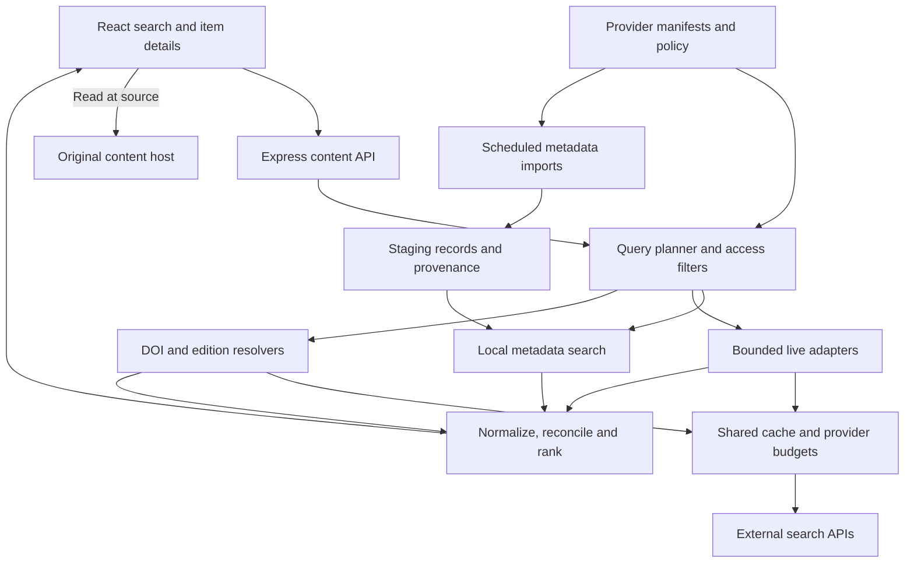

# Free-content discovery architecture

**Current decision (2026-11-03):** the owner requested the
[simple free live plan](SIMPLE_LIVE_PLAN.md). One source is queried live per
request, with signed provider paging and no data-store prerequisite. That plan
supersedes the shared cache/quota/session design below, which is retained as
historical scaling research rather than a launch requirement.

Implementation update (2026-11-01): the delivered bounded catalogs use bundled,
read-only metadata and local search; PostgreSQL is not a prerequisite for this
release. Shared Redis coordinates live paper sources. The owner has accepted
verified free source accounts, represented separately as `free_account_required`.
See [current contracts/progress](IMPLEMENTATION.md), [source operations](OPERATIONS.md)
and [the reviewed children's set](CHILDREN_REVIEW.md). The scale architecture below
remains planning guidance where it differs from those implemented choices.

Proposed design, originally researched 2026-10-31 and reconstructed for the canonical MyBookshelf-web repository. Scope: search metadata and link users to content at its existing host. No connectors, migrations or runtime changes are implemented by this branch.

## 1. System shape

Use a **hybrid search service**: index small explicitly redistributable catalogs locally; federate selected APIs for large/fast-moving collections; resolve identifiers and access links on demand. Keep the existing React/Express stack.



Reading traffic goes directly from browser to host. The server handles metadata, not PDF/EPUB proxying. Embedding is unnecessary initially and many hosts disallow framing.

| Approach | Benefits | Costs / failures | Decision |
| --- | --- | --- | --- |
| Live-only federation | Little storage; fresh upstream search | Quotas, latency, incompatible paging, dependencies on every query | Use for a few large indexes |
| Index everything | Predictable ranking/filtering | Huge imports, rights, freshness, infrastructure | Avoid broad scholarly database imports initially |
| Hybrid | Independent catalog search plus specialist coverage | Two ingestion paths, provenance reconciliation | Recommended |

A modular service is enough; providers are modules, not microservices. A separate scheduled process/job can use the same normalization code.

## 2. Fit with the current repository

Canonical base for this transfer: `9f5bb4b` in `ddk220-light/MyBookshelf-web`. React lives in `client/`, anonymous Express `/api/v2` in `server/`. Current app routes use `/app/`. Existing caches/rate limits are process-local and shelves are browser data. Account persistence is separately planned, not implemented. Coordinate shared persistence decisions with that plan rather than introducing a competing book identity system.

| Existing area | Proposed work |
| --- | --- |
| `server/public-v2/router.js`, `validation.js`, `contracts.js` | Add content-specific search/resolve validation and responses. Do not map all scholarly errors to library catalog failures. |
| `server/public-v2/metadata.js`, `server/services/bookMetadata.js` | Retain exact ISBN/Open Library/Google identity behavior. Free-reading access is new evidence, not circulation availability. Factor only genuinely shared request code. |
| `server/services/providers/` | Keep library adapters separate. New `server/services/content/` must not require branch holdings, patrons, loans, holds or circulation `checkAvailability`. |
| `server/services/providers/http.js` | Reuse timeout/cache/queue concepts after checking suitability. Current maps cannot enforce quotas across Vercel instances. |
| `client/src/v2/ui/scan/`, `ui/book/` | Add Free books / Research scopes and content details. Papers need bibliographic cards without mandatory covers/ISBNs. |
| [Work-aware search](../../work-aware-search.md) | Preserve explicit work/edition relationships and the rule that fuzzy titles do not prove identity. |

Proposed modules:

```text
server/services/content/
  registry.js       # source capabilities, permissions, budgets, mappings
  search.js         # planning, fan-out, ranking and paging
  normalize.js      # identifiers, records, relations, provenance
  access.js         # eligibility and outbound reading actions
  adapters/         # source/protocol adapters
  imports/          # metadata ingestion and checkpoints
server/public-v2/content.js
client/src/v2/ui/content/
```

Do not add global indexes to the geographic library directory. Preserve existing ISBN/work/catalog keys; introduce content keys independently. Adding papers to shelves needs an explicit later storage decision. The outbound-link MVP needs no shelf migration. Current Vercel requests must not depend on writable local disk or SQLite.

## 3. Canonical model

Separate **conceptual work**, **edition/version**, **source record**, and **access location**. A flat `Book { isbn, pdfUrl }` cannot represent translations, preprints, chapters and multiple hosts.

Proposed contract sketch, not production code:

```ts
type Item = {
  key: string; // stable opaque app key, not a temporary URL
  kind: 'book' | 'chapter' | 'article' | 'preprint' | 'thesis'
      | 'report' | 'learning_resource' | 'audiobook' | 'other';
  title: string;
  contributors: Array<{ name: string; role: string; orcid?: string }>;
  identifiers: Array<{ scheme: string; value: string }>;
  languages: string[]; // normalized BCP-47 where possible; retain original value
  subjects: string[];
  audience?: { label?: string; readingLevel?: string; sourceId: string };
  publishedAt?: string;
  version?: string;
  container?: { title: string; issn?: string; volume?: string; issue?: string };
  relations: Array<{ kind: string; targetKey: string; evidence: string }>;
  locations: AccessLocation[];
  provenance: Array<{
    sourceId: string; sourceRecordId: string; recordUrl: string;
    retrievedAt: string; modifiedAt?: string; mappingVersion: string;
  }>;
};

type AccessLocation = {
  id: string;
  landingUrl: string;
  readerUrl?: string;
  downloads: Array<{ url: string; mimeType: string }>;
  access: 'free_full_text' | 'free_account_required' | 'preview' | 'borrow' | 'registration'
        | 'restricted' | 'metadata_only' | 'unknown';
  license?: { id?: string; url?: string; statement?: string };
  rightsJurisdiction?: string;
  country?: string; // applies to this observation, when known
  version?: 'submitted' | 'accepted' | 'published' | 'other';
  evidence: { sourceId: string; field: string; observedAt: string };
  linkCheck?: { checkedAt: string; outcome: 'reachable' | 'broken' | 'unknown' };
};
```

Free full text is an access claim, not reuse permission. HTTP 200 is not free-reading evidence: login pages can return 200. Preserve field-level provenance when choosing conflicting titles/languages/licenses/URLs. Abstracts/covers are optional and must respect source display/storage terms. Journal browsing would use a separate Container entity, not a fake readable item. Exclude datasets/software unless their categories are explicitly enabled.

Identity rules:

1. Normalize exact DOI, ISBN-10/13 equivalence, PMID/PMCID and provider IDs. Valid DOI syntax does not establish existence.
2. Reconcile descriptions of the same identified version, retaining all locations and provenance. Conflicting authoritative metadata goes to review.
3. Keep translations, editions, chapters, abridgements and recordings separate. ISBN is edition-level; ISSN container-level. Missing ISBN is valid.
4. Preserve arXiv versions and Zenodo version DOI separately from concept/unversioned identifiers. Preprint and journal article can be related without being identical. Relations require source evidence.
5. Use title/author similarity only for candidate review or visual grouping, never authoritative merging.
6. Assign durable app IDs to persisted records; alias older source-native keys rather than breaking links after reconciliation.

## 4. Source registry and adapters

Each manifest declares source name/role, official docs/review date, supported item kinds/languages/query fields/filters/sorting, exact-ID resolution, paging/harvesting, credential references, full-text evidence mapping, allowed origins, attribution and metadata reuse policy. Include global rate/concurrency/daily-budget limits, timeouts/cache policy, jurisdiction caveats, source owner, last contract check and feature flag.

Use explicit evidence status: `live_sample`, `docs_only`, `partner_required`, `blocked_check`. A successful old sample is not permission to enable a provider before current requirements are met.

```ts
interface ContentSource {
  search?(request: ProviderQuery, context: RequestContext): Promise<ProviderPage>;
  resolve?(sourceRecordId: string, context: RequestContext): Promise<SourceRecord>;
  locate?(identifier: Identifier, context: RequestContext): Promise<AccessLocation[]>;
  harvest?(checkpoint: Checkpoint, context: JobContext): AsyncIterable<HarvestPage>;
}
```

`ProviderPage` carries mapped records, opaque source cursor, status/warnings and optional source-local total with semantics. Context includes deadline/abort signal, contact, credential accessor and shared budget client. Escape each provider's query grammar; do not send user text as arbitrary Solr/OAI syntax.

Unpaywall implements `locate`, not search. Crossref enriches bibliography. OAI implements `harvest` and feeds a local-index search adapter. Unsupported filters must be rejected or disclosed, never silently ignored while presenting supposedly filtered results.

## 5. Search and item resolution

Proposed POST routes match the existing API style:

```text
POST /api/v2/content/search
  { query, kinds?, languages?, access: "free_full_text", country?, cursor?, limit? }
POST /api/v2/content/resolve
  { key }
```

1. Validate query length, filters, page size (initial max 40), country and cursor binding. Detect ISBN/DOI/arXiv/PMCID before broad search. Country is access context, not legal assurance.
2. Choose providers by user scope/capabilities. Books start from local catalogs; papers use OpenAlex when configured plus at most two relevant specialists. Without the broad index, disclose narrower DOAJ/Europe PMC/arXiv coverage.
3. Use shared cached results. Acquire global quota tokens for uncached requests; arXiv pacing includes all replicas/jobs. Skip with explicit status if the queue cannot run before the deadline.
4. Bound fan-out: proposed 5-second total search deadline, shorter per-provider limits where feasible, at most 3 live providers and one source page each. These are design targets, not measured guarantees. Busy arXiv queues cannot delay every result indefinitely.
5. Map, filter, reconcile and rank. Avoid detail requests for every hit; resolve uncertain access for bounded visible candidates or on item open. Unknown candidates cannot be advertised as free.
6. Return items, source statuses and freshness. Empty, timeout, throttled, quota-exhausted, unsupported and disabled differ. If all sources fail with no local/cached result, return retriable unavailable, not zero matches.
7. On item open, enrich locations as needed; surface editions/versions and host actions. Cache bibliography separately from access observations.

Example partial response:

```json
{
  "items": [],
  "nextCursor": null,
  "coverage": "partial",
  "sources": [
    { "id": "doaj", "status": "ok", "returned": 0 },
    { "id": "arxiv", "status": "timeout", "retryable": true }
  ]
}
```

### Ranking and paging

Use lexical relevance, title/author exactness, identifier matches, requested language and access evidence. Reciprocal-rank fusion can combine incomparable provider scores. Citation/download counts are not default quality judgments. Show source-supplied preprint/retracted/corrected status without implying independent verification.

Federation cannot promise a global total or globally newest-first order without sufficient indexing. Show loaded counts and source coverage. Restrict global sort to fully indexed scopes or explain/reject unsupported sorting.

Keep a short-lived server-side search session in shared cache: query/filter hash, selected sources, provider cursors, buffered unused records, emitted IDs, exhaustion/failure state and index revision. Return a signed opaque token with initial 15-minute expiry. This prevents skipped buffered results, duplicate pages and credential leaks. Preserve order within a session; failed sources retain retry state rather than becoming exhausted. Expiry starts a new query without deleting displayed results.

### Reading actions

Prefer durable supplied landing/reader URLs over guessed PDF paths or signed URLs. Labels must accurately distinguish Read at host, Download EPUB/PDF, Preview, Borrow and View source record. Exclude unknown access by default from Read free; optional broader discovery can show it explicitly.

Show index and host separately when useful, e.g. Found via DOAJ / Read at publisher. Preserve required attribution. Broken PDF links should fall back to evidenced landing/alternate locations, never invented files. Expose freshness/country limits in details. A public-domain US scan is not a universal legal-access assertion.

## 6. Persistence, refresh and operations

Use managed PostgreSQL for the bounded local catalogs, identifiers, relations, locations, source policies and harvest checkpoints. Coordinate with planned account persistence; this is not approval for migrations or a universal catalog. PostgreSQL full-text search can serve initial catalogs; add a specialized engine only when size, typo tolerance or multilingual needs justify it. Test Tamil/Indic and other non-Latin queries; English stemming is not multilingual search.

Use Redis or equivalent atomic shared KV for search cache, coalescing, sessions, circuit breakers and source rate/daily budgets. Memory-only implementations can support local development, not cross-instance production limits. Object storage is optional for permitted metadata snapshots; do not store raw copyrighted text by default. No writable local disk/SQLite dependency in Vercel request paths.

A reviewed static metadata snapshot/in-process search is a smaller initial option if bundle/memory measurements permit. It still needs shared live-provider budgeting. Provision no paid infrastructure as a side effect of a connector.

Proposed defaults, always subordinate to provider terms:

| Data | Initial freshness | Failure behavior |
| --- | --- | --- |
| Live query | 15-minute cache; stale fallback up to 24 hours | Explicit stale/partial, bounded lifetime |
| Bibliography | 1–7 days by provider | Retain source/time |
| Access evidence | Re-evaluate on open when older than 24 hours | Downgrade unknown/conflicting evidence |
| Imports | Daily checks when supported; monthly dumps on their schedule | Retain last successful index and show age |
| Negative lookup | Short cache, e.g. 5 minutes | Never cache an error as absence |
| Links | Sampled/background and on-open checks | 403/anti-bot means unknown, not automatic deletion |

Import sequence: approved metadata fetch → size/schema/revision validation → normalized staging → count/deletion sanity checks → reconciliation → atomic index activation. Commit OAI pages before checkpointing. Use overlapping datestamp windows, idempotent upserts, tombstones and periodic reconciliation. Granularity/deletion support vary. Expired resumption tokens restart safely from durable windows. Failed/empty snapshots must never wipe the catalog.

Honor Retry-After; jittered exponential backoff within deadlines; stop retrying missing-permission 401/403 indefinitely. Quota exhaustion returns local/cached coverage plus status. Disable one source via flag without taking down discovery.

Measure per-source requests/cache hits/latency/timeouts/429s/budget, usable free-link rate, missing evidence, duplicates, cursor errors, harvest lag/deletions and sampled broken links. Avoid raw query logs by default; aggregate operations suffice initially.

## 7. Rights and network boundaries

Keep separate: permission to ingest/display metadata, ability to read content, and permission to reuse content. CC0 metadata does not make PDFs CC0. Public-domain status depends on jurisdiction; free copyrighted reading can still prohibit redistribution.

Only approved adapters make server requests. Validate source next-page URLs/cursors against expected origins/paths; escape queries and sanitize metadata HTML. Allow web schemes for displayed outbound links. A server-side link checker must reject private/reserved addresses and revalidate DNS/redirects to avoid SSRF. Never turn user-supplied URLs into arbitrary server fetches. Keep credentials out of logs, client variables and public URLs; do not persist signed downloads as identity or fixtures.

No cross-site cookies, account creation, login replay or paywall bypass is needed. Handle removals, embargoes, retractions and policy changes through source updates/removal mechanisms.

## 8. Delivery and acceptance

### Phase A — contract and two vertical slices

Define manifests/model/access eligibility/shared budgeting/routes. Implement Gutenberg import/local search and Europe PMC live search to prove both paths. Add cards/details/host actions behind a flag and sanitized fixtures under source terms.

Exit: book/paper queries lead to real host links; preview/borrow/metadata-only fixtures cannot enter the free filter; one failure retains other results; no dependence on a public demo or writable local disk.

### Phase B — initial coverage

Add Open Textbook Library, DOAJ and arXiv; OpenAlex after key/budget verification. Then DOAB/OAPEN imports and optional Unpaywall resolver with real contact email. Keep Google/Open Library enrichment bounded.

Exit: DOI duplicates consolidate without collapsing versions/chapters/translations; paging retains buffered items; quotas work across two instances; failed refresh cannot delete active index.

### Phase C — children, regional and specialist coverage

Reviewed children's pilot with approved metadata, attribution, language and level. Obtain feeds for comprehensive StoryWeaver/African Storybook/Book Dash search. Add CORE/HAL/Zenodo and India-specific providers in response to measured gaps; audio optional.

Exit: every enabled provider has ingestion permission, refresh owner, stable link mapping and tested access policy. Partner-pending/catalog-only coverage stays explicitly scoped.

Before release verify:

- Provider contracts: valid/empty/malformed response, missing fields, absent license, preview/borrow/embargo, stale links, 429/503 and schema drift.
- Identity: same DOI across indexes, preprint vs publication, arXiv versions, translations, chapter vs book, missing ISBN, unrelated same title, Zenodo concept vs version DOI.
- Search: partial/all-source failure, exhausted budget, unsupported filters, cancellation, no skipped/duplicate pages, expired cursor, honest totals.
- Imports: interrupted/repeated OAI page, tombstone, expired token, corrupt/empty bulk file and rollback.
- End-to-end: title/author/DOI, free filters, details, external HTML/reader/PDF/EPUB where offered, browser back, unchanged ISBN/library/shelf flows; launch-country checks beyond server-region behavior.
- Capacity: uncached searches/day and peak concurrency. At the observed OpenAlex price, ordinary search cost is uncached calls × $0.001; paging/enrichment add requests. arXiv 1/3 sec is at most 20/min before contention. Configure degradation before enabling traffic.

This documentation-only branch needs document/link/JSON checks, not runtime tests. Implementation should run server/client suites, typecheck/build, targeted connector/import tests and opt-in live smoke checks; unit tests should not depend on networking.

## 9. Inputs still needed for implementation

Verify the configured OpenAlex key with an actual authenticated request and select a real application contact email. Decide expected traffic and commercial/noncommercial use before setting quotas and eligibility. Choose initial children's languages/levels and launch countries before feeds and access validation. No missing input blocks this research or its publication; the proposal itself authorizes no new paid resources or accounts.
